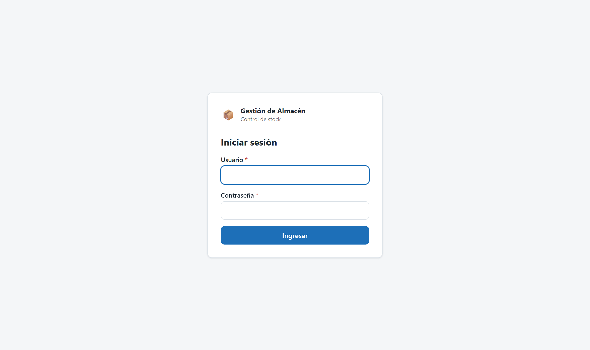

# 7. Manual de instalación y configuración

Pasos para dejar el sistema funcionando en una computadora con Windows 10 u 11.

## 7.1 Programas necesarios

| Programa | Versión usada | Para qué |
|---|---|---|
| JDK de Java | 25.0.1 | Compilar y ejecutar el backend |
| MySQL Server | 8.0.42 | Base de datos |
| MySQL Workbench | 8.0 | Ver la base y probar consultas. Opcional |
| Node.js | 24.14.1 | Ejecutar el frontend |
| Git | Cualquiera reciente | Descargar el proyecto |

Maven no se instala: el proyecto trae el ejecutable `mvnw`, que lo descarga solo la primera vez.

## 7.2 Descargar el proyecto

```bash
git clone https://github.com/nicosobrero14-hue/sistema-gestion-almacen.git
```

```bash
cd sistema-gestion-almacen
```

## 7.3 Crear la base de datos

Con MySQL en ejecución, desde la carpeta del proyecto:

```bash
mysql -u root -p < base-de-datos/01-esquema.sql
```

```bash
mysql -u root -p gestion_almacen < base-de-datos/02-datos-de-prueba.sql
```

El primero crea la base `gestion_almacen` y sus siete tablas. El segundo carga los datos de prueba.

Para verificar que quedó bien:

```bash
mysql -u root -p -e "SHOW TABLES;" gestion_almacen
```

Tienen que aparecer las siete tablas: `detalle_venta`, `movimientos_stock`, `pagos`, `productos`,
`proveedores`, `usuarios` y `ventas`.

Los datos de prueba traen diez productos. Los ocho que tienen código de barras vienen con su foto,
que es la que trajo el catálogo público cuando se los escaneó. La base guarda solo el nombre del
archivo, así que los archivos hay que copiarlos aparte, desde `base-de-datos/imagenes-de-prueba/` a
la carpeta donde el sistema guarda las fotos:

```bash
mkdir -p ~/gestion-almacen/imagenes && cp base-de-datos/imagenes-de-prueba/*.jpg ~/gestion-almacen/imagenes/
```

Esa carpeta se configura en `application.properties`, en `app.images.folder`, y por defecto queda
dentro de la carpeta del usuario. Está fuera del proyecto a propósito: las fotos son datos del
comercio, no código, y no tienen por qué viajar en el repositorio ni perderse al actualizarlo.

Si los archivos no se copian no pasa nada grave: los productos aparecen con un recuadro con la
inicial, que es lo mismo que se ve mientras el comercio todavía no cargó sus fotos. Los otros dos
productos, que se venden por kilo, arrancan así a propósito.

Las fotos están acreditadas en `base-de-datos/imagenes-de-prueba/CREDITOS.md`, porque la licencia
del catálogo lo pide.

## 7.4 Configurar la conexión

Las credenciales de MySQL no están en el repositorio. Hay que crear el archivo local:

1. Ir a `gestion-almacen/src/main/resources/`.
2. Copiar `application-local.properties.ejemplo` y renombrar la copia como
   `application-local.properties`.
3. Abrirla y completar el usuario y la clave del MySQL propio:

```properties
spring.datasource.username=root
spring.datasource.password=la_clave_de_tu_mysql
```

Git ignora ese archivo, así que la clave nunca se sube al repositorio.

## 7.5 Arrancar el backend

```bash
cd gestion-almacen
```

```bash
mvnw spring-boot:run
```

La primera vez tarda algunos minutos porque descarga las dependencias. Cuando termina, en la consola
aparece `Started GestionAlmacenApplication`. El backend queda escuchando en el puerto 8080.

Para comprobarlo, en el navegador: `http://localhost:8080/api/status`. Tiene que responder:

```json
{ "application": "ok", "database": "ok" }
```

## 7.6 Arrancar el frontend

En otra consola:

```bash
cd gestion-almacen-frontend
```

```bash
npm install
```

```bash
npm run dev
```

El sistema queda disponible en `http://localhost:5173`.

`npm install` se ejecuta una sola vez, la primera. Después alcanza con `npm run dev`.

## 7.7 Verificar la instalación

Abrir `http://localhost:5173`. Aparece la pantalla de inicio de sesión.



Los datos de prueba traen dos usuarios:

| Usuario | Contraseña | Rol |
|---|---|---|
| `admin` | `Admin1234` | Administrador |
| `vendedor` | `Empleado1234` | Empleado |

**Son contraseñas de prueba.** Antes de usar el sistema en el comercio hay que cambiar la del
administrador desde la pantalla de usuarios, y dar de baja o modificar el usuario `vendedor`.

Después de entrar, en el panel principal tienen que aparecer las dos tarjetas de estado en **Ok**:
una para la aplicación y otra para la base de datos. Con los datos de prueba, además, la leche
aparece en la alerta de stock bajo.


Si la tarjeta de base de datos dice "sin conexión", revisar el punto 7.4.

## 7.8 Problemas frecuentes

| Problema | Causa y solución |
|---|---|
| `Port 8080 was already in use` | Hay otro programa en ese puerto, o quedó una ejecución anterior abierta. Cerrarla o cambiar `server.port` en `application.properties` |
| `Access denied for user 'root'@'localhost'` | El usuario o la clave de `application-local.properties` no coinciden con los de MySQL |
| `Unknown database 'gestion_almacen'` | Falta ejecutar el script del punto 7.3 |
| `Schema-validation: missing table` | La base existe pero le faltan tablas. Volver a ejecutar el esquema |
| La pantalla carga pero dice que no se pudo conectar | El backend no está en ejecución. Arrancarlo con `mvnw spring-boot:run` |
| `mvnw` no se reconoce como comando | Hay que ejecutarlo desde la carpeta `gestion-almacen` |
| "Usuario o contraseña incorrectos" con los usuarios de prueba | Falta cargar los datos de prueba del punto 7.3 |
| La hora de los movimientos no coincide con la real | El backend guarda la hora de la computadora en la que corre. Si MySQL está en otra computadora, las dos tienen que tener la misma zona horaria |

## 7.9 Ejecutar las pruebas automáticas

```bash
cd gestion-almacen
```

```bash
mvnw test
```

Las pruebas usan una base en memoria, así que no necesitan MySQL ni modifican los datos reales.

## 7.10 Impresora de tickets

Es opcional: sin impresora, el ticket se ve igual en pantalla.

1. Instalar la impresora en Windows con el driver del fabricante, como cualquier impresora.
2. Imprimir una página de prueba desde Windows para confirmar que funciona.
3. En el sistema, después de una venta, apretar "Imprimir" en el ticket y elegir esa impresora en
   el diálogo.

El sistema no necesita ninguna configuración: la hoja de estilos de impresión deja solo el
comprobante, con el ancho de un ticket de 80 mm. Si el navegador agrega el encabezado y el pie con
la dirección y la fecha, se quitan en el diálogo, en "Más opciones", desmarcando "Encabezados y pies
de página".

## 7.11 Preparar las fotos de los productos

El sistema acepta cualquier JPG, PNG o WEBP de hasta 2 MB, así que se puede subir una foto sacada
con el celular y listo. El problema es que cada foto llega con un tamaño distinto y la grilla de la
pantalla de venta queda despareja.

Para eso está `herramientas/normalizar-imagen.py`, que recorta el borde que sobra, centra el
producto y lo deja de 600×600 sobre blanco:

```bash
python herramientas/normalizar-imagen.py fotos-del-comercio/
```

Necesita Pillow, que se instala con `pip install Pillow`. Toma una foto suelta o una carpeta entera.

Lo que el script **no** hace es borrar el fondo. Eso necesita un modelo de visión y queda fuera del
alcance de este trabajo, así que la foto tiene que entrar ya con el fondo claro: alcanza con apoyar
el producto sobre una hoja blanca o contra una pared clara y sacarle la foto de frente.

## 7.12 Lector de código de barras

Es opcional: sin lector, los códigos se pueden escribir a mano.

1. Conectar el lector a un puerto USB. Windows lo reconoce solo, como un teclado.
2. Abrir el Bloc de notas y leer el código de cualquier producto. Tienen que aparecer los números
   y el cursor tiene que bajar de renglón. Eso significa que el lector aprieta Enter al terminar,
   que es lo que el sistema necesita.
3. Si el cursor no baja de renglón, hay que activar el sufijo Enter (en inglés, *CR* o *Enter
   suffix*) con el código de configuración que trae el manual del lector.

En el sistema no hay nada que configurar. Para usarlo, el cursor tiene que estar en el buscador de
la venta o del catálogo.
