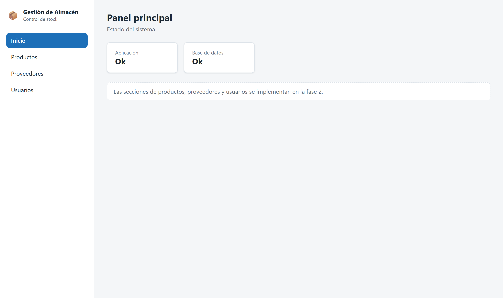
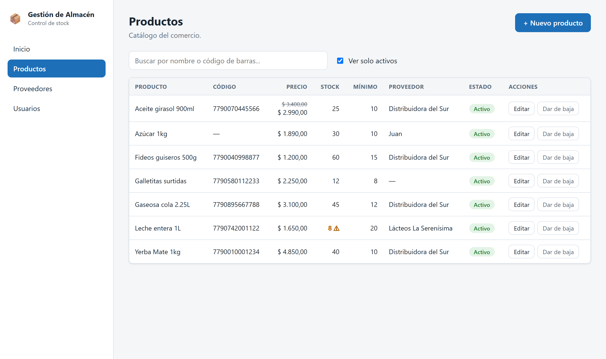
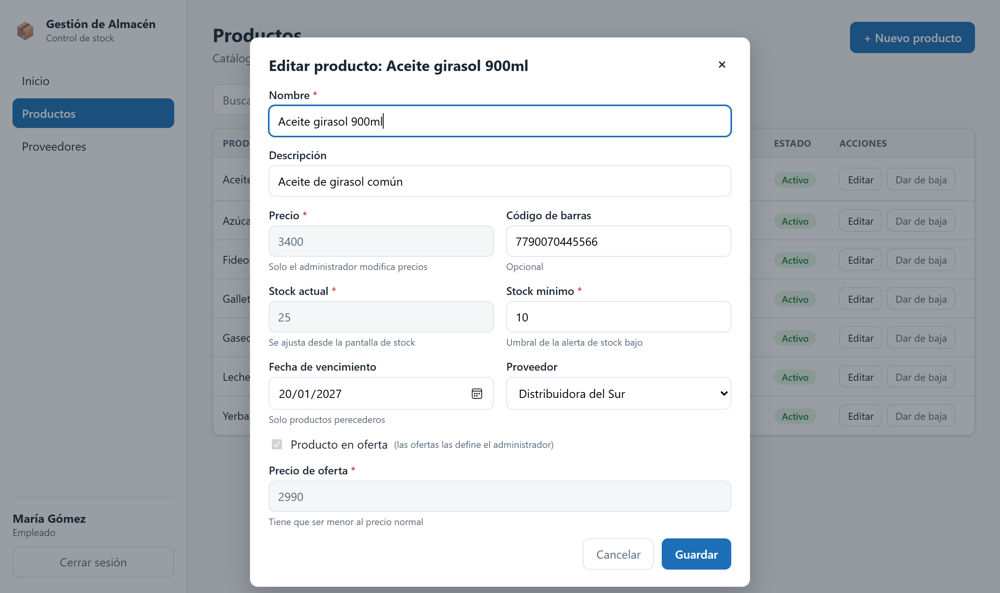
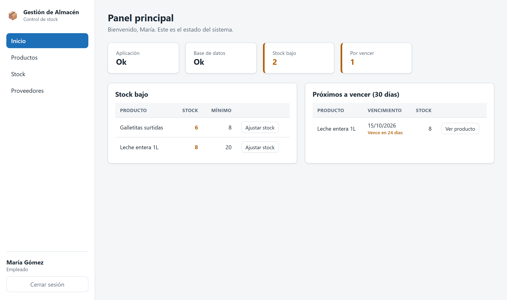
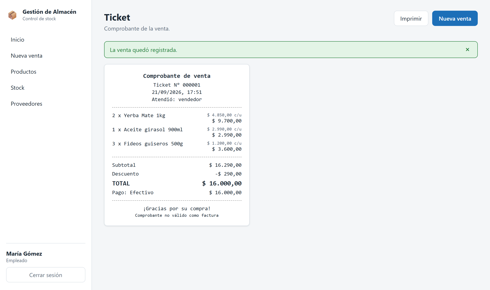
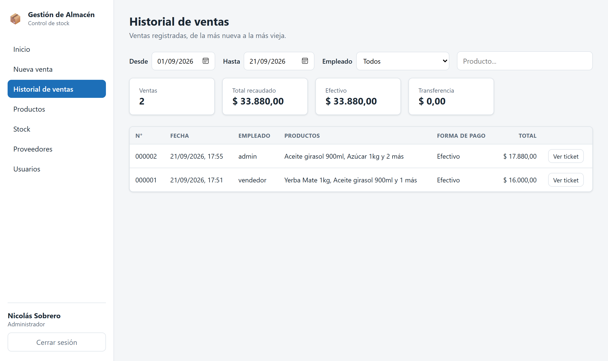
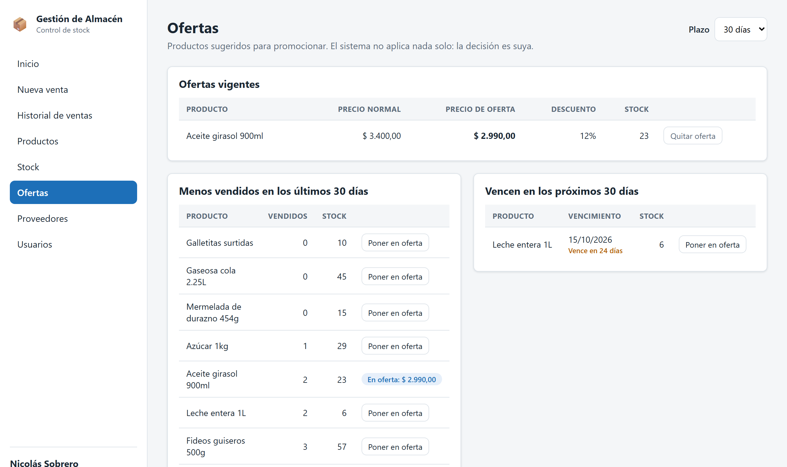
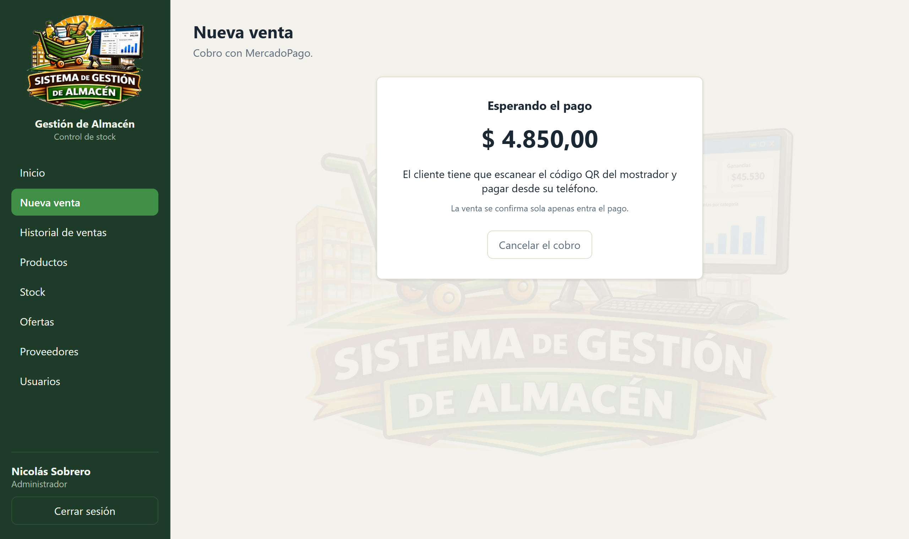

# 10. Bitácora del desarrollo

Registro de lo que se hizo en cada fase, las decisiones que se tomaron y cómo se verificó el
resultado.

---

## Fase 0 — Repositorio, documentación y modelo de datos

**20 de septiembre de 2026**

### Qué se hizo

1. Se creó el repositorio con la estructura de carpetas: `base-de-datos/`, `documentacion/` y las
   dos carpetas del código, que se completan en la fase siguiente.
2. Se escribió el esquema completo de la base: siete tablas con sus claves, restricciones e
   índices.
3. Se cargaron los datos de prueba: dos usuarios, tres proveedores y ocho productos, con casos
   variados a propósito (con y sin código de barras, con y sin vencimiento, uno bajo el mínimo,
   uno en oferta y uno dado de baja). En la fase 13 pasaron a ser diez productos reales, con su
   código de barras de verdad y su foto.
4. Se escribieron diez consultas de ejemplo que cubren las necesidades de los requisitos.
5. Se documentó el análisis, la arquitectura, las tecnologías y el modelo de datos, con sus dos
   diagramas.

### Decisiones

**El modelo de datos se diseña completo desde el principio, no fase por fase.** Las tablas de
ventas y pagos se crean ahora aunque el módulo de ventas llegue en la fase 5. Diseñar el modelo
entero de una vez evita tener que modificar tablas más adelante, que es cuando aparecen los
problemas: datos que migrar, código que ajustar y consultas que revisar.

**El número de ticket es el identificador de la venta.** No se agrega una secuencia aparte. El
comercio no emite comprobantes fiscales, así que no hay requisito de numeración propia.

**Las alertas no se guardan en la base.** Se calculan con una consulta cada vez que se abre el
panel. Una alerta guardada queda desactualizada apenas cambia el stock.

El detalle de estas decisiones y del resto está en `04-modelo-datos.md`.

### Cómo se verificó

El esquema se ejecutó sobre una base temporal, separada de la de desarrollo:

- Las siete tablas se crearon sin errores y los datos de prueba cargaron completos: 3 proveedores,
  8 productos, 2 usuarios y 8 movimientos de carga inicial.
- Se intentó insertar diez datos inválidos (stock negativo, precio en cero, oferta más cara que el
  precio, rol inexistente, usuario repetido, correo repetido, código de barras repetido, descuento
  mayor al subtotal, cantidad cero y tipo de movimiento inventado). La base los rechazó a todos.
- Se cargó una venta completa con dos renglones, su pago y sus movimientos de stock. El stock quedó
  consistente con la suma de los movimientos.
- Se borró un proveedor: sus cuatro productos sobrevivieron, sin proveedor asignado.
- Se borró un producto vendido: el renglón de la venta conservó el nombre y el precio.
- Se borró una venta: se fueron sus renglones y su pago, y el movimiento de stock quedó registrado.

La base temporal se eliminó al terminar.

### Estado al cerrar la fase

La base de datos está diseñada, documentada y probada. El repositorio tiene la documentación de las
cuatro primeras actividades de la guía. Falta el código, que empieza en la fase 1.

---

## Fase 1 — Esqueleto

**20 de septiembre de 2026**

### Qué se hizo

1. Se creó el proyecto del backend con Spring Boot, conectado a MySQL.
2. Se agregó un endpoint de estado, `GET /api/status`, que informa si la aplicación responde y si la
   base contesta.
3. Se creó el proyecto del frontend con React y Vite, con el menú lateral y las cuatro secciones.
4. La pantalla de inicio consulta el estado y lo muestra.
5. Se escribió el manual de instalación.

### Decisiones

**El código se escribe en inglés y la base de datos queda en español.** Las clases, las variables y
las rutas de la API usan la convención del lenguaje. Las tablas y columnas mantienen los nombres del
análisis, así el diccionario de datos y el modelo se leen igual en los dos lados. La unión la hacen
las anotaciones `@Table` y `@Column`.

**El endpoint de estado existe para poder probar la cadena completa.** Sin él, el frontend de esta
fase no tendría nada que pedirle al backend y no habría forma de demostrar que las tres partes se
comunican.

**La seguridad todavía no se configura.** Se agrega en la fase 3, junto con el inicio de sesión.
Sumarla antes obligaría a dejar todo abierto con una configuración provisional que después habría
que reescribir.

**El backend arranca con `validate`.** Hibernate no modifica las tablas: solo verifica que el mapeo
coincida con lo que hay en la base. Si una entidad no coincide, la aplicación no levanta y el error
aparece enseguida, no cuando un dato se guarda mal.

### Cómo se verificó

- `mvnw test`: 2 pruebas en verde, el arranque del contexto y la respuesta del endpoint de estado.
- El backend levantó contra MySQL y quedó registrado `Started GestionAlmacenApplication`.
- La pantalla de inicio muestra las dos tarjetas en **Ok**, lo que prueba el camino completo:
  React, el proxy de Vite, Spring Boot y MySQL.
- El frontend compila para producción con `npm run build`.

### Estado al cerrar la fase

El sistema arranca de punta a punta. Las secciones de productos, proveedores y usuarios están en el
menú pero todavía sin contenido: se implementan en la fase 2.

---

## Fase 2 — Proveedores, productos y usuarios

**21 de septiembre de 2026**

### Qué se hizo

1. Las tres entidades con su mapeo a las tablas: `Supplier`, `Product` y `User`.
2. Para cada una: DTO con validaciones, repositorio con búsqueda, servicio con sus reglas y
   controlador con seis endpoints (listar, traer, crear, modificar, dar de baja y reactivar).
3. Un manejador de errores único, que devuelve siempre el mismo formato: mensaje general y error de
   cada campo.
4. El hash de contraseñas con BCrypt.
5. Las tres pantallas, con tabla, buscador, filtro de activos y formulario en una ventana.
6. 25 pruebas automáticas nuevas.
7. Los documentos de módulos, API y pruebas.

### Decisiones

**No hay borrado definitivo, solo baja y reactivación.** Un producto dado de baja sigue figurando
en las ventas que ya se hicieron, y un usuario dado de baja sigue siendo quien las registró. El
borrado rompería ese historial. Además simplifica la interfaz: dos botones por fila en lugar de
tres, y ninguna confirmación en dos pasos.

**El stock se carga solo en el alta.** Al editar un producto el campo queda bloqueado. En la fase 4
el stock se va a ajustar desde su propia pantalla, que deja registrado quién lo cambió y por qué.
Si también se pudiera cambiar desde la edición del producto, ese registro tendría huecos.

**Servicios con interfaz.** Cada servicio tiene su interfaz (`IProductService`) y su clase
(`ProductService`). El controlador depende de la interfaz, así la clase puede cambiar sin tocarlo.

**Solo la biblioteca de contraseñas de Spring Security.** Para hashear hace falta BCrypt, pero la
configuración completa de seguridad llega con el inicio de sesión en la fase 3. Por ahora se agregó
únicamente `spring-security-crypto`.

**Los roles guardan los mismos valores que la base.** El enumerado `Role` tiene `ADMIN` y
`EMPLEADO`, que son los códigos que acepta la columna `rol`. Son datos, no nombres de código.

### Cómo se verificó

- `mvnw test`: 27 pruebas en verde.
- El backend arrancó contra MySQL sin errores de validación del esquema: las entidades en inglés
  coinciden con las tablas en español.
- Recorrido en el navegador de las tres pantallas, con los datos de prueba reales.
- Se probaron las reglas en pantalla sin modificar los datos: el formulario vacío, la edición, el
  aviso al dar de baja un producto con stock y el intento de dar de baja al único administrador.

El detalle de los 48 casos de prueba y de las incidencias encontradas está en `09-pruebas.md`.

### Estado al cerrar la fase

El sistema administra el catálogo, los proveedores y los usuarios. Todavía no pide iniciar sesión:
eso llega en la fase 3, junto con los permisos por rol.

---

## Fase 3 — Inicio de sesión y permisos por rol

**21 de septiembre de 2026**

### Qué se hizo

1. La configuración de seguridad: qué endpoints son públicos, cuáles pide sesión y cuáles son solo
   del Administrador.
2. El inicio de sesión, el cierre y la consulta de quién está conectado.
3. La búsqueda del usuario en la base para Spring Security, que compara la contraseña contra el
   hash BCrypt.
4. Los errores 401 y 403 en el manejador global, con mensajes en español.
5. La regla de precios y ofertas: solo las cambia el Administrador.
6. La pantalla de inicio de sesión, el usuario conectado al pie del menú y el botón para cerrar
   sesión.
7. 14 pruebas automáticas nuevas, y las 25 anteriores adaptadas para correr con sesión.

### Decisiones

**Sesión con cookie y no un token en el navegador.** El sistema corre en una terminal dentro del
comercio. Con la sesión guardada en el servidor, cerrar sesión la invalida de verdad, y la cookie
no la puede leer ningún script. Un token en JavaScript no tiene ninguna de las dos cosas.

**Protección CSRF activada.** Al usar una cookie de sesión, otra página podría intentar mandar
pedidos en nombre del usuario. El servidor deja un token en otra cookie y exige que vuelva en una
cabecera. El frontend lo manda solo, con una línea de configuración en axios.

**El precio y la oferta son del Administrador.** No estaba en el issue original, pero sale del
documento de análisis: el Administrador tiene acceso adicional a *"ofertas y modificación de
precios"* (CU-19 y CU-20). El Empleado sigue poniendo el precio al dar de alta un producto, porque
el alta es parte de su trabajo (CU-02); lo que no puede es cambiarlo después.

**Los permisos se controlan en el servidor.** El frontend esconde lo que el rol no puede usar, pero
eso es comodidad. Las pruebas CP-58, CP-61 y CP-62 llaman a la API directamente, sin pasar por la
pantalla, y verifican que el servidor rechaza el pedido.

**El usuario conectado vive en el componente principal.** Se pasa por props a las pantallas que lo
necesitan: el menú, el inicio y productos. Para tres pantallas no hace falta armar un contexto
global.

**El estado del sistema sigue siendo público.** Solo informa si la aplicación y la base responden,
y así el manual de instalación puede verificarlo sin iniciar sesión.

### Cómo se verificó

- `mvnw test`: 41 pruebas en verde.
- En el navegador, contra MySQL, con los dos usuarios de prueba: login con campos vacíos y con
  contraseña incorrecta, el menú y el formulario de cada rol, la sesión al recargar y el cierre de
  sesión, que deja a `/api/auth/me` respondiendo 401.

### Estado al cerrar la fase

El sistema pide usuario y contraseña, y cada rol ve y puede hacer solo lo que le corresponde. Lo
que sigue es el control de stock y las alertas del panel principal.

---

## Fase 4 — Stock y alertas

**21 de septiembre de 2026**

### Qué se hizo

1. La entidad `StockMovement`, que mapea la tabla `movimientos_stock`, creada en la fase 0 y sin
   uso hasta ahora.
2. El ajuste manual de stock: stock nuevo y motivo, con el movimiento registrado junto al usuario
   de la sesión y la fecha.
3. La carga inicial: el alta de un producto ahora deja registrado su stock inicial como primer
   movimiento.
4. Las dos consultas de alertas: stock bajo y próximos a vencer.
5. La pantalla de stock, con la ventana de ajuste y el historial de movimientos de cada producto.
6. Las alertas en el panel principal, con acceso directo al producto de cada una.
7. 10 pruebas automáticas nuevas. Las de productos se adaptaron: como el alta registra quién cargó
   el stock, el usuario de la sesión tiene que existir en la base de prueba.

### Decisiones

**Se ingresa el stock nuevo, no la diferencia.** En el comercio el stock se corrige contando lo que
hay en la estantería. Pedir el número contado evita la cuenta mental; la diferencia la calcula el
formulario y la muestra antes de guardar.

**El stock tiene su propio recurso en la API.** No se cambia con un `PUT` al producto, como el
resto de sus datos, porque cada cambio tiene que pasar por un ajuste con motivo. Tenerlo aparte
hace imposible cambiar el stock sin dejar el movimiento.

**El cambio de stock y su movimiento se guardan en la misma transacción.** Si el movimiento no se
pudiera guardar, el stock tampoco cambia. Así la suma de los movimientos nunca se separa del stock
actual.

**El movimiento se arma en su constructor.** Recibe el producto ya actualizado y el usuario, y
copia de ellos el nombre, el usuario y el stock nuevo. El alta de productos y el ajuste lo usan
igual, y la venta de la fase 5 también lo va a usar.

**El usuario de la sesión lo resuelve el servicio de usuarios.** `getSessionUser()` lo toma del
contexto de seguridad de cada pedido. Así el controlador no tiene que pasarlo, y el endpoint
`/api/auth/me` usa el mismo método.

**El plazo de vencimiento es un parámetro.** La alerta usa 30 días, pero el endpoint recibe el plazo.
Las sugerencias de ofertas de la fase 7 van a necesitar otro plazo y pueden usar la misma consulta.

**El stock mínimo se sigue configurando en el producto.** La pantalla de stock solo ajusta stock,
así todo lo que pasa por ella deja un movimiento.

### Cómo se verificó

- `mvnw test`: 51 pruebas en verde.
- El backend arrancó contra MySQL sin errores de validación: `StockMovement` coincide con la tabla.
- En el navegador, con el usuario `vendedor`: las alertas del panel con los datos de prueba, los dos
  accesos directos, los errores del formulario de ajuste y un ajuste real de las galletitas, de 12
  a 6 unidades, que las dejó por debajo del mínimo y las sumó a las alertas.
- En MySQL: la hora del movimiento coincide con la del servidor, y la consulta 10 no encontró
  productos con el stock distinto de la suma de sus movimientos.

Durante las pruebas apareció una diferencia de 3 horas entre los movimientos guardados por la
aplicación y los cargados con los scripts. La causa era el parámetro `serverTimezone=UTC` en la
dirección de conexión, que venía de la fase 1. Se quitó. El detalle está en `09-pruebas.md`.

### Estado al cerrar la fase

Cada cambio de stock queda registrado, y el panel avisa qué productos hay que reponer y cuáles
están por vencer. Falta el cambio de stock que más se repite: la venta, que llega en la fase 5.

---

## Fase 5 — Venta y ticket

**21 de septiembre de 2026**

### Qué se hizo

1. Las entidades `Sale`, `SaleDetail` y `Payment`, que mapean `ventas`, `detalle_venta` y `pagos`.
2. El registro de la venta: renglones con el precio del momento, descuento, pago y descuento de
   stock con su movimiento, todo en una transacción.
3. El precio de venta de cada producto (`salePrice`): el de oferta si está en oferta.
4. La pantalla de nueva venta: búsqueda, carrito, descuento, forma de pago y vuelto.
5. La pantalla del ticket, con su versión para imprimir.
6. 13 pruebas automáticas nuevas.

### Decisiones

**El carrito vive en la pantalla.** Mientras se arma no se guarda nada en la base. Así no quedan
ventas a medias si el cliente se arrepiente, y no hace falta limpiar carritos abandonados. El
servidor recibe la venta completa al confirmar.

**Del carrito solo viajan el producto y la cantidad.** El precio lo busca el servidor. Si el
navegador mandara el precio, cualquiera podría cambiarlo antes de confirmar.

**El servidor vuelve a controlar el stock al confirmar.** La pantalla ya lo controla mientras se
arma el carrito, pero entre que se busca un producto y se confirma, otra venta pudo llevarse las
últimas unidades.

**Un producto no puede aparecer en dos renglones.** El carrito suma las unidades en un solo
renglón. Si llegaran dos, cada uno pasaría el control de stock por separado y se podría vender más
de lo que hay.

**El descuento tiene que ser menor al subtotal.** Un total de cero no es una venta, y la tabla de
pagos no acepta pagos de cero pesos.

**Efectivo y transferencia, sin MercadoPago.** Las dos se cobran en el momento, así que la venta
nace confirmada y el pago aprobado. MercadoPago queda para más adelante: necesita credenciales,
una dirección pública con HTTPS para recibir el aviso del pago, y es lo único del sistema que
depende de un servicio externo. El modelo de datos ya lo contempla.

**El ticket se arma con los datos de la venta.** No se guarda un archivo aparte: los renglones
tienen copia del nombre y del precio, así que el ticket siempre sale igual.

**La impresión usa el diálogo del navegador.** La impresora de tickets se instala en Windows como
cualquier otra, y la hoja de estilos de impresión deja solo el comprobante con el ancho del papel.
No hace falta ningún programa ni driver especial en el sistema.

**Los renglones y el pago se traen junto con la venta.** El ticket siempre los necesita. Se
declararon como `Set` y no como `List` porque Hibernate no puede traer dos `List` en la misma
consulta.

### Cómo se verificó

- `mvnw test`: 64 pruebas en verde.
- El backend arrancó contra MySQL sin errores de validación de las tres tablas nuevas.
- En el navegador, con el usuario `vendedor`: el producto inexistente, los topes de stock, el
  descuento inválido y el vuelto, sin guardar nada. Después, una venta real de 2 yerbas, 1 aceite en
  oferta y 3 fideos, con $290 de descuento, en efectivo: ticket N° 000001 por $16.000.
- En MySQL: las consultas 6, 7 y 8 muestran la venta, sus renglones y lo recaudado; los tres
  movimientos de venta tienen el número de venta; la consulta 10 no encontró diferencias entre el
  stock y los movimientos.

### Estado al cerrar la fase

El comercio ya puede vender: el carrito, el cobro, el descuento de stock y el ticket funcionan de
punta a punta. Lo que sigue es poder consultar las ventas hechas y cargar productos con el lector
de código de barras.

---

## Fase 6 — Historial de ventas y lector de código de barras

**21 de septiembre de 2026**

### Qué se hizo

1. El historial de ventas en la API: las ventas de un período, con filtro por empleado y por
   producto, solo para el Administrador.
2. La pantalla del historial, con el total recaudado y el total por forma de pago, y el acceso al
   ticket de cada venta.
3. La búsqueda de un producto por su código de barras exacto.
4. El lector en la venta, que agrega al carrito, y en el catálogo, que abre la ficha.
5. El alta de un producto con el código leído, cuando no existe.
6. Un solo archivo con los formatos de precios y fechas, que estaban copiados en cinco pantallas.
7. 9 pruebas automáticas nuevas.

### Decisiones

**El historial trae las ventas con sus renglones y su pago en una sola consulta.** La consulta usa
`JOIN FETCH`. Sin eso, Hibernate haría una consulta más por cada venta de la lista.

**Las relaciones que no salen en la respuesta se cargan solo si se usan.** Mirando las consultas en
el log apareció que, al traer ventas o movimientos, Hibernate buscaba también el producto de cada
renglón y el usuario de cada venta, que nunca se muestran. Esas relaciones pasaron a `LAZY`.

**Los filtros del historial van en la dirección de la página.** Así, al abrir un ticket y volver,
el historial sigue igual. Además, un historial filtrado se puede guardar como favorito.

**El producto se filtra por nombre en los renglones.** Es la copia que se guardó al vender, así que
funciona aunque el producto haya cambiado de nombre o esté dado de baja.

**El lector se trata como lo que es: un teclado.** Un Enter con solo números en el buscador es una
lectura. No hace falta configurar el lector ni instalar nada, y la búsqueda por nombre no cambia.

**El buscador de la venta recupera el foco después de cada producto.** El lector escribe donde está
el cursor. Si después de tocar un botón el cursor quedara en otro lado, la lectura se perdería.

### Cómo se verificó

- `mvnw test`: 73 pruebas en verde.
- En el navegador, contra MySQL: el historial con las dos ventas del mes, los filtros, el ticket y
  la vuelta con los filtros puestos, y el Empleado sin acceso. El lector se probó escribiendo el
  código y apretando Enter, que es lo que hace el lector real: la venta con tres lecturas, un código
  inexistente dado de alta en el momento y la ficha abierta desde el catálogo.
- En el log del backend: una sola consulta para el historial y una para el ticket.
- En MySQL: la consulta 10 no encontró diferencias entre el stock y los movimientos.

### Estado al cerrar la fase

El Administrador puede revisar las ventas y lo recaudado, y la carga de productos en la caja es
tan rápida como pasar el lector. Queda la última fase: las sugerencias de ofertas y el cierre del
proyecto.

---

## Fase 7 — Ofertas

**21 de septiembre de 2026**

### Qué se hizo

1. La sugerencia por baja rotación: los productos con stock que menos se vendieron en un plazo.
2. Poner y quitar ofertas desde la API de ofertas, solo para el Administrador.
3. La pantalla de ofertas: las vigentes, los menos vendidos y los próximos a vencer, con un plazo
   de 15, 30 o 60 días.
4. La ventana para poner una oferta, que muestra el descuento mientras se escribe.
5. 9 pruebas automáticas nuevas.

### Decisiones

**Las sugerencias no aplican nada.** RF-10 lo pide así: la oferta la decide el Administrador. La
pantalla muestra candidatos y un botón; nada cambia hasta que se apreta.

**La baja rotación se calcula con una sola consulta.** Un `LEFT JOIN` contra los renglones de venta
del período, agrupado por producto, así los productos sin ventas aparecen con cero. La consulta ya
devuelve los 10 primeros ordenados.

**La sugerencia por vencimiento reusa la alerta.** En la fase 4 el endpoint de vencimientos quedó
con el plazo como parámetro pensando en esto. La pantalla de ofertas lo llama con el plazo elegido.

**Las unidades vendidas salen en un DTO.** Es la única respuesta que no es una entidad: las
unidades vendidas no son un dato del producto, se calculan.

**Una oferta más cara que el precio normal no se puede confirmar.** CU-19 exc. 4a menciona
confirmar o corregir; se dejó solo corregir, porque la base de datos rechaza ese caso desde la
fase 0.

### Cómo se verificó

- `mvnw test`: 82 pruebas en verde. Una de ellas mueve una venta 40 días atrás para comprobar que
  no cuenta en un plazo de 30.
- Contra MySQL: la baja rotación coincide con las dos ventas registradas.
- En el navegador, con el usuario `admin`: la pantalla con las tres secciones, el precio de oferta
  inválido, las galletitas puestas en oferta a $1.800 y la oferta quitada, que dejó la base como
  estaba. Con `vendedor`: sin acceso.

### Estado al cerrar la parte de ofertas

Todos los requisitos funcionales del análisis están implementados, salvo MercadoPago (CU-10), que
se resolvió en la fase 8.

## Fase 8 — Cobro con MercadoPago

**18 de octubre de 2026**

### Qué se hizo

1. La forma de pago MercadoPago: la venta nace pendiente y el cobro se abre sobre la caja del
   comercio, cuyo código QR está impreso en el mostrador.
2. La confirmación automática: el sistema consulta el cobro y, cuando el dinero entra, confirma la
   venta y descuenta el stock.
3. La baja del cobro cuando el cliente no paga, dejando la venta cancelada y el stock intacto.
4. La pantalla de espera, el número del cobro en el ticket y el filtro del historial.
5. 9 pruebas automáticas nuevas: 91 en total.

### Decisiones

**La venta se parte en dos momentos.** Antes `saveSale` registraba, aprobaba el pago y descontaba
el stock de corrido. Ahora armar la venta y confirmarla son pasos separados, porque con un pago
digital los separa el tiempo que tarda el cliente. Ese cambio se hizo primero y solo, sin tocar el
comportamiento, con las 82 pruebas existentes como red.

**El stock se descuenta al cobrar, no antes.** Lo pide la excepción 4a de CU-11 y es lo correcto:
un cliente que no paga no puede dejar el stock mal. El riesgo opuesto, que entre el pago y la
confirmación alguien venda la última unidad, no existe acá: hay una sola caja y el cajero está
esperando frente al cliente. Igual el sistema no deja el stock negativo y lo registra en el
movimiento si llegara a pasar.

**El sistema pregunta en vez de esperar un aviso.** MercadoPago notifica los pagos haciendo un
pedido a una dirección pública con certificado, y la computadora del comercio no lo es. Exponerla
implicaría redirección de puertos y dominio propio, una configuración frágil para un mostrador. El
sistema consulta mientras el cobro está abierto: el resultado para el usuario es el mismo.

**La pasarela está detrás de una interfaz.** Las pruebas usan una implementación falsa, así las 91
corren sin internet y sin credenciales. Es lo que permitió construir y probar casi todo el cobro
antes de tener la cuenta configurada.

### Cómo se verificó

- Con las pruebas automáticas: 91 en verde, 9 de esta fase.
- Contra la cuenta de prueba real de MercadoPago: la venta queda pendiente sin tocar el stock, el
  cobro se cancela y el stock sigue intacto, y el sistema sin configurar responde con un mensaje
  útil sin registrar una venta a medias.
- **Con un pago de verdad**: se generó una venta de $6.500 con dos productos, se escaneó el código
  del mostrador desde la aplicación con la cuenta de prueba compradora y se pagó. La venta pasó
  sola a confirmada y el stock se descontó recién ahí: yerba de 28 a 27 y leche de 6 a 5, con un
  movimiento por producto.

### Un problema que apareció

La documentación de MercadoPago indica usar la Orders API para el cobro con QR, y esa API responde
403 en **todos** sus endpoints para la cuenta del comercio. Se descartó que fuera un problema de
credenciales o de datos: el mismo token funciona en otros endpoints, y el 403 aparece igual en modo
estático, en dinámico y hasta enviando un pedido sin el bloque de QR, sin llegar a validar el
cuerpo. Es un bloqueo de esa API para esa cuenta.

La salida fue la API Instore, anterior pero todavía vigente, que sí está habilitada y resuelve el
mismo circuito. Tiene tres diferencias que quedaron anotadas en el código: crear el cobro no
devuelve identificador, así que se usa el número de venta como referencia; consultar la orden
también está bloqueado, así que el estado se obtiene buscando un pago aprobado con esa referencia;
y la dirección del pedido lleva la sucursal.

Antes aparecieron dos obstáculos menores. La caja creada desde el panel quedaba sin identificador
externo y en modo no integrado, y el panel no permite configurar ninguno de los dos: hubo que
corregirla por API. Y el manejo de errores decía siempre "no se pudo contactar a MercadoPago",
incluso cuando MercadoPago había respondido rechazando, y descartaba el motivo; ahora distingue los
dos casos y deja el detalle en el log, que es lo que permitió diagnosticar todo lo anterior.

### Estado al cerrar la fase

Los once requisitos funcionales del análisis están implementados. Queda el diseño de interfaz, la
venta por peso con la balanza y el cierre: el manual de usuario, la planilla final de pruebas, las
conclusiones y la presentación.

---

## Fase 9 — Cantidades decimales y venta por peso

**19 de octubre de 2026**

### Qué se hizo

1. Cinco columnas de cantidad pasaron de entero a `DECIMAL(10,3)`: el stock y el mínimo del
   producto, la cantidad del renglón de venta, y el stock anterior y nuevo de cada movimiento.
2. La columna `unidad_venta`, que define si el precio de un producto es por unidad o por kilo.
3. El redondeo del subtotal de cada renglón a dos decimales, con una regla única.
4. El frontend, que ahora muestra las cantidades según cómo se vende el producto: "12" para algo
   que se cuenta y "0,120 kg" para algo que se pesa, y el precio como "$ 12.000,00/kg".
5. La migración `04-migracion-decimales.sql`, para las bases que ya estaban creadas.

### Decisiones

**El problema es anterior a la balanza.** La balanza es la fase 10, pero no tiene sentido conectar
una balanza a un sistema donde la cantidad es un número entero: un fiambre de 120 gramos no entra
en ningún campo y el stock de ese producto queda mal desde la primera venta. Por eso los decimales
se hicieron antes y solos, como paso previo.

**Una columna para todos los productos, y no una tabla aparte para los que se pesan.** La primera
idea fue tratar los embutidos como un caso especial. Habría significado duplicar la lógica de
stock, la de venta y la de movimientos, con dos caminos que hay que mantener iguales para siempre.
Un producto que se vende por kilo no es otra cosa que un producto: es el mismo producto con otra
unidad. Una columna alcanza.

**Tres decimales y no dos.** Es lo que entrega una balanza de mostrador y es lo que se necesita
para los gramos: 0,120 kg son 120 gramos. Con dos decimales, 125 gramos no se podrían representar.

**La migración no transforma datos.** Un stock de 3 pasa a 3,000, que es el mismo número. Los
productos que ya existían quedan por unidad, que es como se venían vendiendo. Una migración que no
puede perder información es una migración que se puede correr sin miedo.

**El subtotal se redondea en un solo lugar.** Por peso, el importe casi nunca da exacto: 0,120 kg
a $12.000 el kilo son $1.440, pero 0,137 kg dan $1.644 con un resto. Redondear a dos decimales con
una sola regla, en el método que calcula el subtotal, evita que cada pantalla redondee distinto y
que el total no coincida con la suma de los renglones.

### Cómo se verificó

- Con las pruebas automáticas: las 91 que ya existían siguieron pasando **sin cambiar ninguna
  aserción**. No se agregó ninguna prueba nueva en esta fase, y es una decisión discutible: el
  cambio era de tipos, no de comportamiento, y las 91 existentes cubrían el comportamiento. Eso
  sirvió para lo que tenía que servir, como se cuenta abajo.
- A mano, con un caso real de mostrador: un producto a $12.000 el kilo, del que se venden 0,120 kg.
  El sistema cobró $1.440 y el stock pasó de 3 a 2,880 kg, con el movimiento registrado.

### Un problema que apareció

El cambio de tipos rompió una consulta que el compilador no podía ver. La consulta de productos
menos vendidos arma un objeto directamente desde JPQL, y al pasar la cantidad a decimal el
constructor dejó de coincidir con lo que la consulta devolvía. Como ese error aparece al construir
el contexto de la aplicación y no al compilar, el resultado fue que **las 91 pruebas fallaron de
golpe**, todas, antes de ejecutar ninguna.

Visto en frío es el mejor resultado posible: el error se vio en el primer intento y en la máquina
de desarrollo. Pero deja algo anotado para el documento final, porque contradice una idea cómoda:
que en un lenguaje con tipos el compilador encuentra todo. Una consulta escrita como texto es texto
hasta que alguien la ejecuta.

Después, ya en el frontend, aparecieron dos pantallas en blanco seguidas. La primera, al abrir el
formulario de un producto: una variable que decidía si el producto se vendía por peso se leía antes
de que existiera el estado del que dependía. La segunda, en la pantalla de stock, por una función
de formato que se usaba sin importarla. Las dos se arreglaron en minutos, pero las dos se vieron
recién abriendo el navegador: ninguna de las 91 pruebas podía encontrarlas, porque todas prueban el
backend.

### Estado al cerrar la fase

El sistema puede representar y cobrar cantidades fraccionarias de punta a punta: base, API,
pantalla y ticket. Falta la balanza, que es la que va a entregar ese número sola en vez de que el
empleado lo escriba.

---

## Entre fases — Datos sugeridos al escanear un código

**19 de octubre de 2026**

Esta parte no estaba planificada. Apareció al conectar el lector de código de barras de verdad, ya
terminada la fase 9, y se hizo en el momento porque cambiaba algo del uso diario.

### Qué pasó

El lector funcionaba desde la fase 6, pero hasta ese día se había probado con códigos escritos a
mano. Con el lector físico en la mesa quedó claro algo obvio en cuanto se ve: el lector escribe el
número y nada más. Para dar de alta un producto nuevo había que escribir el nombre, el precio, el
stock y el resto a mano, uno por uno. Un almacén con cientos de productos no se carga así.

La idea salió de una prueba de un minuto: el mismo código, escaneado con el teléfono, abre una
página que dice qué producto es. Si esa información está pública, el sistema puede pedirla.

### Qué se hizo

1. La consulta del código en catálogos públicos abiertos, que devuelve un nombre sugerido.
2. Cuatro catálogos en vez de uno, consultados en orden: alimentos, higiene y cosmética, productos
   en general y alimento para mascotas. Un almacén vende de todos los rubros.
3. El formulario de alta reconoce un código escaneado en el campo del nombre, lo manda a su lugar
   y pide los datos.
4. Los buscadores de Productos, Stock y Nueva venta quedan listos para escanear apenas se abre la
   pantalla, sin tener que hacer clic antes.
5. El nombre del empleado en el ticket y en el detalle de la venta, en lugar del nombre de usuario.
6. 3 pruebas automáticas nuevas: 94 en total.

### Decisiones

**No poder sugerir no es un error.** Si el catálogo no conoce el código, o no hay internet, el
sistema no avisa de una falla: se carga a mano, que es lo que se hacía igual. Por eso la consulta
devuelve vacío en vez de fallar, y la pantalla sigue andando con la conexión caída.

**El catálogo está detrás de una interfaz**, igual que la pasarela de pago. Las pruebas usan un
catálogo falso, así no salen a internet ni dependen de que una base pública esté disponible.

**El nombre que llega es una sugerencia, no un dato.** Los catálogos los cargan personas y vienen
desprolijos: la marca repetida en el nombre, todo en minúsculas, el tamaño a veces sí y a veces no.
El sistema arma el nombre lo mejor que puede y el formulario avisa que hay que revisarlo antes de
guardar. La decisión la sigue tomando el empleado.

**Escanear en el catálogo ya no abre la ficha del producto.** Esto es un cambio al análisis, no un
detalle: el paso 5 de CU-03 dice que al leer un código en la gestión de catálogo se abre la ficha
del producto. Trabajando con el lector en la mano se vio que en el mostrador esa pantalla se usa de
otra forma, como consulta rápida de precios, y que abrir una ficha en cada lectura estorba. Ahora
el código leído filtra el listado y deja el producto a la vista con su precio. Queda registrado
para el anexo de cambios al análisis.

### Cómo se verificó

Con el lector físico, leyendo productos de verdad. El dato más útil salió de ahí: una gaseosa la
reconoció enseguida, y un desodorante no. Esa diferencia llevó a medir la cobertura real.

### Lo que no salió como esperábamos

La cobertura de estos catálogos es muy despareja según el rubro. Medido sobre productos argentinos:

| Catálogo | Rubro | Productos argentinos |
|---|---|---|
| Open Food Facts | Alimentos y bebidas | 16.496 |
| Open Beauty Facts | Higiene y cosmética | 453 |
| Open Products Facts | El resto | 159 |
| Open Pet Food Facts | Alimento para mascotas | 16 |

Los alimentos están razonablemente cubiertos. Todo lo demás, junto, no llega a 630 productos en
todo el país. Por eso el desodorante no aparecía, y por eso sumar los otros tres catálogos ayudó
menos de lo esperado: se sumaron porque es barato hacerlo, no porque resuelvan el problema.

### UPCitemdb: por qué no se sumó

La alternativa que más prometía era UPCitemdb, porque responde sin credenciales y porque sus fichas
traen varias imágenes. Se probó contra once códigos de barras argentinos, los mismos ocho de los
datos de prueba más tres que habían fallado antes.

Conoció **uno** de los once, y esa única ficha venía **sin ninguna imagen**. El mismo día, un código
de los Estados Unidos devolvió la ficha completa con diez imágenes. No es una base incompleta: es
una base norteamericana, armada con las publicaciones de las cadenas de allá. Los códigos que
empiezan con 779, que son los argentinos, prácticamente no están.

El límite de consultas tampoco es el que se había anotado al principio. No es diario: son **seis
consultas cada veinticinco segundos**, y pasadas esas seis responde `429` pidiendo ir más despacio.
Para un mostrador donde se escanea un producto por vez alcanzaría, pero no para cargar un catálogo
de corrido.

Ahora bien, la prueba dejó algo más valioso que el descarte. La imagen que devolvió para el producto
estadounidense es una foto de estudio de 450×450, con el producto centrado y el fondo blanco puro:
se midieron los píxeles del borde y el cien por ciento son blancos. Comparada con las de Open Food
Facts, que son fotos de góndola sacadas con el teléfono, la diferencia no está en la base sino en
**de dónde sale la foto**. Una base colaborativa recibe lo que suben las personas; una base armada
con publicaciones de comercios recibe las fotos de catálogo que esos comercios ya tenían hechas.

Eso cambió cómo mirar la opción que quedaba. Mercado Libre se había dejado de lado por la
cobertura, pero su valor parecía doble: tiene los productos de acá y sus publicaciones usan fotos
de catálogo, que es justo el fondo blanco que se pedía. Así que se la investigó en serio.

### Mercado Libre: encaja técnicamente y lo frena la licencia

Lo primero que se vio es que sin credenciales no se puede medir nada. Se probaron seis endpoints,
incluido `/sites/MLA`, que durante años fue público, y los seis responden `403`. La API está
cerrada por completo.

Leyendo la documentación, lo técnico encaja mejor que en cualquiera de las otras. Un solo llamado
al buscador de productos de catálogo, pasándole el código de barras en `product_identifier`,
devuelve el nombre, los atributos del producto y un arreglo `pictures` con **varias** fotos de
catálogo. Open Food Facts devuelve una sola, y de calidad despareja.

También apareció una salida al obstáculo que se creía insalvable. El flujo normal de OAuth exige
una dirección de redirección con HTTPS obligatorio, que la computadora de un comercio no tiene, el
mismo problema que apareció con los avisos de MercadoPago en la fase 8. Pero Mercado Libre ofrece
además el flujo *Device Grant*, pensado justamente para equipos sin dirección pública: la
aplicación consulta hasta que el usuario autoriza desde otro dispositivo.

Lo que la descarta está en los términos y condiciones del programa de desarrolladores. La cláusula
2.2.1.3 permite "realizar una cantidad limitada de copias intermedias del Contenido de Mercado
Libre" y obliga a "eliminar irreversiblemente las copias intermedias cuando ya no sean necesarias".
La 7.4 prohíbe almacenar ese contenido para fines distintos de los permitidos.

El diseño de este sistema hace exactamente lo contrario. La foto se descarga una vez y se guarda
para siempre, y se eligió así a propósito para que la venta no dependa de internet, que es lo que
pide RNF-04. Eso no es una copia intermedia. La única forma compatible sería mostrar la foto
enlazada en vivo, que es justamente lo que se descartó.

Es un caso interesante para anotar: de todas las alternativas evaluadas, esta es la que mejor
encaja técnicamente, y la que queda afuera por una razón que no es técnica. Vale la pena decirlo
porque al elegir una API se suele mirar qué devuelve y qué tan difícil es conectarla, y no bajo qué
condiciones se permite usar lo que devuelve.

De paso quedaron anotados otros datos, por si alguna vez se retoma: crear una aplicación en
Argentina exige validar antes los datos del titular de la cuenta, el token de acceso dura seis
horas según el texto aunque el ejemplo de la respuesta dice 10.800 segundos que son tres, el
refresh token es de un solo uso, y la aplicación se invalida sola si no se la usa durante cuatro
meses.

La conclusión honesta es que la función cumple con lo que se pedía —cargar lo menos posible a
mano— pero no para todo el catálogo. Para un almacén, donde la mayoría de lo que se vende es
comida y bebida, resuelve buena parte. Para una perfumería no serviría.

---

## Fase 13 — Imágenes de productos y venta visual

**19 al 21 de octubre de 2026**

Las fases 10, 11 y 12 —la balanza, el diseño de interfaz y la paginación— quedaron para después.
Esta se adelantó porque la imagen del producto es un pedido concreto que había que resolver, y
porque la consulta a los catálogos públicos, recién terminada, ya tenía media solución adentro.

### Qué se hizo

1. La columna `imagen` en productos, que guarda el nombre del archivo y no la imagen.
2. La carga y la baja de la foto desde la ficha del producto, con vista previa antes de guardar.
3. La descarga automática de la foto que sugiere el catálogo público al dar de alta un producto
   escaneado.
4. El botón "Traer del catálogo" para los productos que ya estaban cargados sin foto.
5. La miniatura en el listado del catálogo, con un recuadro con la inicial para los que no tienen.
6. La grilla de tarjetas en la pantalla de venta.
7. `herramientas/normalizar-imagen.py`, que deja una foto cuadrada, centrada y con fondo blanco.
8. Los datos de prueba pasaron a ser diez productos reales, con su código de barras y su foto.
9. 15 pruebas automáticas nuevas: 109 en total.

### Decisiones

**La base guarda el nombre del archivo, no la imagen.** Un BLOB engorda cada respaldo de la base y
servir binarios desde la base es más lento que servir un archivo estático. Las fotos viven en una
carpeta del servidor, fuera del proyecto, porque son datos del comercio y no código.

**La foto se descarga, no se enlaza.** Guardar el enlace del catálogo era gratis y no ocupaba
disco, pero la foto desaparece si el catálogo la borra, y sin internet la pantalla de venta queda
llena de imágenes rotas. Eso choca con RNF-04, que pide que el comercio siga vendiendo con la
conexión caída. Se descarga una vez, al dar de alta, y después la foto es del comercio.

**El nombre del archivo sale del id del producto y nunca de lo que manda el cliente.** Si el nombre
lo eligiera quien sube el archivo, uno con `..` podría escribir fuera de la carpeta. Hay una prueba
que manda justamente ese nombre y verifica que el sistema lo ignore.

**Solo se descarga de los catálogos que el sistema consulta.** El enlace de la foto llega desde el
navegador, así que sin esa restricción se podría hacer que el servidor pida cualquier dirección,
incluso una de la red interna del comercio. Es una lista de cuatro direcciones y una prueba que
verifica que un enlace de afuera se ignore.

**La grilla de la venta muestra los productos sin código de barras.** El plan original era mostrar
el catálogo entero sobre el listado paginado, pero la paginación es la fase 12 y todavía no está:
sin paginar, abrir la pantalla cargaría cientos de productos con sus fotos de una sola vez. Mostrar
los que no tienen código resuelve las dos cosas, porque son justo los que no se pueden escanear
—fruta, verdura, fiambre— que es para lo que la grilla sirve, y son pocos.

**El orden es alfabético y no por más vendidos.** En un mostrador la velocidad sale de encontrar el
producto siempre en el mismo lugar. Un orden que se acomoda solo según las ventas mueve las cosas
de sitio cada semana.

**La tabla de antes quedó como vista alternativa**, con un botón para cambiar y la elección
recordada. Entra más productos en la pantalla y le sirve a quien ya se sabe el catálogo de memoria.

### Cómo se verificó

- Con las pruebas automáticas: 109 en verde, 15 de esta fase. Cubren el alta de la imagen, el
  rechazo de un archivo que no es imagen, el de uno de más de 2 MB, el reemplazo de una que ya
  estaba, la baja, el nombre de archivo mandado por el cliente, y que la foto anterior se conserve
  si la descarga falla.
- En el navegador, con productos reales y el lector físico: se escaneó una gaseosa que el sistema
  no tenía, el catálogo devolvió el nombre y la foto, la vista previa la mostró antes de guardar y
  al guardar el archivo quedó en el disco del servidor. Después se quitó la foto y se comprobó que
  el archivo desapareciera de la carpeta y la columna quedara vacía.
- Cancelar el formulario después de traer una foto no cambia nada: se verificó contra la base que
  ni el código ni la imagen se hubieran tocado.

### Dos problemas que aparecieron

**Los códigos RF-12 y CU-21 estaban puestos en dos cosas distintas.** Los issues de imágenes se
escribieron antes que el anexo de la balanza, y después ese anexo tomó los mismos dos códigos para
la venta por peso y el pesaje. Durante un tiempo las dos funciones, que no tienen nada que ver,
figuraban con la misma identificación. Se detectó al ir a escribir un issue nuevo y se resolvió
dejando RF-12 y CU-21 para la balanza, que es lo que dice el documento entregado, y moviendo las
imágenes a RF-14 y CU-22. Hubo que corregir cinco issues y quince comentarios del código.

**Una tercera pantalla en blanco**, de la misma familia que las dos de la fase 9. El botón para
traer la foto del catálogo pregunta si el producto tiene un código de barras cargado, y lo hacía
sobre el valor crudo. Las columnas que la base admite vacías llegan en nulo, así que en un producto
sin código esa pregunta rompía la pantalla antes de dibujar nada. No se vio al programarlo porque
todos los productos de prueba de ese momento tenían código: apareció recién al cargar los primeros
que se venden sueltos. Se arregló en el origen, pasando a texto vacío los campos que la base admite
vacíos al abrir el formulario, para que no vuelva a pasar con otro campo.

Tres pantallas en blanco en dos fases, ninguna encontrada por las 109 pruebas, todas encontradas
abriendo el navegador. No es casualidad y queda anotado para las conclusiones: las pruebas de este
proyecto cubren el backend, y el frontend se verifica a mano.

### Lo que no salió como esperábamos

La foto que devuelve el catálogo público casi nunca tiene fondo blanco. De las ocho que se bajaron
para los datos de prueba, solo dos están sobre fondo limpio: el resto son fotos sacadas con el
teléfono en la góndola del supermercado, sobre una mesada de granito o sostenidas con la mano.
Tiene sentido, porque es un catálogo colaborativo y las carga cualquiera, pero choca con el pedido
original, que era ver el producto solo, sobre blanco.

La conclusión es que la descarga automática resuelve la **cobertura** y no la **presentación**. Son
dos problemas distintos y se confundieron en uno al planificar. La cobertura la resuelve el
catálogo; la presentación la resuelve la herramienta de normalización, pero solo hasta donde puede,
porque recorta, centra y cuadra la imagen sin tocar el fondo. Borrar el fondo necesita un modelo de
visión y queda fuera del alcance de este trabajo.

Para el comercio eso no es un problema: la foto del producto en la góndola alcanza para
reconocerlo, y el empleado siempre puede reemplazarla por una propia. Para las capturas del
documento sí, y por eso las fotos definitivas de los datos de prueba se sacan aparte, sobre una
hoja blanca, y pasan por la misma herramienta.

### Estado al cerrar la fase

Los productos tienen foto en el catálogo, en la ficha y en la pantalla de venta, y se cargan solas
cuando el catálogo las tiene. Quedan la balanza, el diseño de interfaz, la paginación y el cierre.

